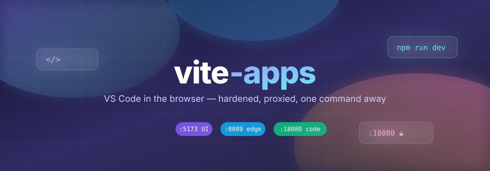
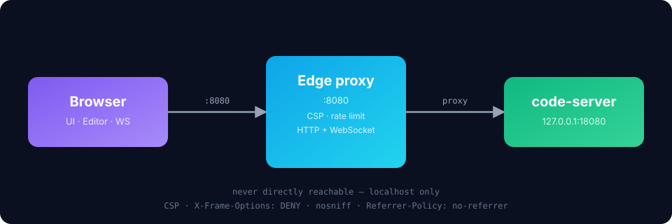
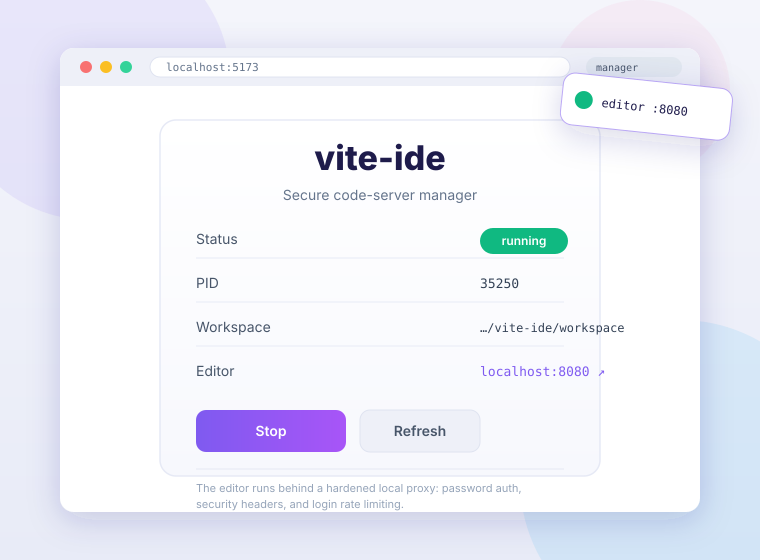
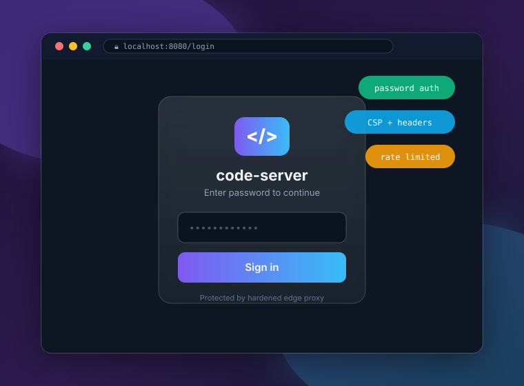

<div align="center">



# ⚡ vite-ide

**A Vite app that runs a hardened, password-protected [code-server](https://github.com/coder/code-server)** — VS Code in the browser — behind a security-conscious edge proxy, with a small management UI to start, stop, and monitor it.

[](https://nodejs.org)
[](https://vite.dev)
[](https://www.typescriptlang.org)
[](LICENSE)
[](#security-notes)

</div>

---

## 📖 Table of contents

- [✨ Features](#-features)
- [🏗️ Architecture](#-architecture)
- [🚀 Quick start](#-quick-start)
- [🖥️ Using the manager UI](#-using-the-manager-ui)
- [⚙️ Configuration](#-configuration)
- [🌐 Remote access (TLS)](#-remote-access-tls-required)
- [🏭 Production](#-production)
- [📜 Logs](#-logs)
- [🛠️ Troubleshooting](#-troubleshooting)
- [🔐 Security notes](#-security-notes)

---

## ✨ Features

| | |
|---|---|
| 🖥️ **Browser IDE** | Full VS Code experience via code-server — no install, works over SSH or on a NAS |
| 🛡️ **Hardened proxy** | Edge layer adds CSP, `X-Frame-Options: DENY`, `nosniff`, `Referrer-Policy: no-referrer`, and login rate limiting |
| 🔒 **Password auth** | `code-server --auth password` — secret passed via env var, never on the command line |
| 📊 **Manager UI** | Tiny Vite dashboard to check status, start/stop the server, and grab the editor link |
| 🔕 **Privacy-first** | Telemetry and update checks disabled; user data & extensions persist in `.code-server-data/` |
| 🚢 **One-command prod** | `npm run build && npm run server` — serves `dist/` and manages code-server with no dev server |

---

## 🏗️ Architecture



```text
browser ──> Vite UI (:5173)            management dashboard (status / start / stop)
browser ──> edge proxy (:8080)         security headers + login rate limit + WS
              └──> code-server (:18080, 127.0.0.1 only)  the actual editor
```

- **code-server** binds to `127.0.0.1:18080` — never directly reachable.
- The **edge proxy** (same Node process as the Vite plugin) is the only public surface.
- Auth is `code-server --auth password` with the password passed via the `PASSWORD` env var — **never** on the command line.
- Telemetry and update checks are disabled; workspace trust is off; user data and extensions live under `.code-server-data/`.

---

## 🚀 Quick start

```bash
npm install
cp .env.example .env
# set a strong PASSWORD in .env, e.g.: openssl rand -base64 24
npm run dev        # UI on :5173, autostarts code-server
```

Then open **<http://localhost:5173>** — the manager dashboard:

<p align="center">
  
</p>

1. Check the **Status** badge — it should read `running` (autostarted by `npm run dev`)
2. Click the **Editor** link, or open <http://localhost:8080> directly
3. Log in with `PASSWORD` from your `.env`:

<p align="center">
  
</p>

<details>
<summary>📦 Install the code-server binary manually</summary>

The binary is auto-installed to `vendor/code-server` on first start, or run:

```bash
npm run install:code-server
```

</details>

---

## 🖥️ Using the manager UI

The dashboard at `http://localhost:5173` is served by Vite and talks to the
same Node process that owns the edge proxy. It polls
`/api/code-server/status` every 5 seconds.

| Element | What it does |
|---|---|
| **Status badge** | `stopped` · `starting` · `running` · `error` — live state of code-server |
| **PID** | Process ID of the running code-server instance (when running) |
| **Workspace** | Folder opened in the editor (`CODE_SERVER_WORKSPACE`) |
| **Editor** | Deep link to `PUBLIC_EDITOR_URL` — opens the login page in a new tab |
| **Start / Stop** | `POST /api/code-server/start` / `/stop` — control the backend |
| **Refresh** | Force an immediate status re-fetch |

Error states surface in plain language in the **Error** row — e.g. a missing
`PASSWORD` shows a `Config` warning, and proxy failures show the underlying
`listen` error.

---

## ⚙️ Configuration

All settings live in `.env` (see [`.env.example`](.env.example)):

| Variable | Default | Purpose |
|---|---|---|
| `VITE_PORT` | `5173` | Management UI port |
| `EDGE_PORT` / `EDGE_BIND` | `8080` / `127.0.0.1` | Public proxy address |
| `CODE_SERVER_PORT` | `18080` | Internal code-server port (localhost only) |
| `PASSWORD` | — | **Required.** Editor login password |
| `CODE_SERVER_WORKSPACE` | `./workspace` | Folder opened in the editor |
| `PUBLIC_EDITOR_URL` | `http://localhost:8080` | URL shown in the UI |
| `CODE_SERVER_AUTOSTART` | `1` | Set `0` to disable autostart on `vite dev`/`preview` |

---

## 🌐 Remote access (TLS required)

> ⚠️ **Never expose `EDGE_PORT` directly** — it is plain HTTP. Terminate TLS in front of it:

```bash
caddy run --config deploy/Caddyfile   # see deploy/Caddyfile
```

Then set `PUBLIC_EDITOR_URL=https://ide.example.com` in `.env`.

---

## 🏭 Production

```bash
npm run build && npm run server   # serves dist/ + manages code-server, no Vite dev server
```

---

## 📜 Logs

- **Edge/manager logs:** Vite console
- **code-server logs:** `.code-server-data/logs/code-server.log` (+ `.err.log`)

---

## 🛠️ Troubleshooting

| Symptom | Cause | Fix |
|---|---|---|
| UI loads on `:5174` (or higher) with an `edge proxy failed: EADDRINUSE` error | A second `npm run dev` auto-incremented the Vite port but can't bind `EDGE_PORT` `8080` — only one instance can own the proxy | Use the lowest port (`:5173`); kill duplicates with `pkill -f "vite"` or `kill <pid>` |
| Status stuck on `starting` | code-server still booting | Wait a few seconds and hit **Refresh**; check `.code-server-data/logs/code-server.log` |
| `Config` warning: `Set PASSWORD in .env` | `PASSWORD` missing | Add it to `.env` and restart `npm run dev` |
| Editor link unreachable | code-server stopped or proxy down | Start it from the manager; verify `EDGE_PORT` isn't firewalled |
| Port `8080` already in use | Another service holds the edge port | Change `EDGE_PORT` in `.env` and update `PUBLIC_EDITOR_URL` |

To make duplicate dev servers **fail loudly** instead of silently landing on
`:5174`, add `strictPort: true` under `server` in `vite.config.ts`.

---

## 🔐 Security notes

- code-server grants **full shell access** to anyone who logs in — treat `PASSWORD` like a root password: keep it unique and rotate it if exposed.
- `.env`, `vendor/`, `.code-server-data/`, `workspace/` are gitignored — **never commit them**.
- The CSP allows `'unsafe-inline'`/`'unsafe-eval'` because VS Code's web workbench requires them; everything else is locked down (`frame-ancestors 'none'`, `base-uri 'self'`, restrictive `Permissions-Policy`).

---

<div align="center">

Made with ❤️ for people who live in the browser.

</div>
